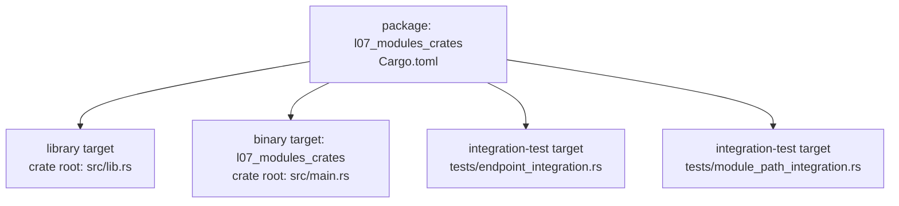

# 第七课：module、crate、package 与可见性

前六课的程序都能放进一个文件。真实的程序很快会超过这个规模：同一个名字要在不同地方表示不同意思，一份解析逻辑要被可执行程序、测试甚至别的项目同时使用，有些辅助函数又不该让外部随便调用。单文件写法在这些需求面前会同时失去三样东西：名字的清晰、代码的复用、边界的保护。

Rust 用四层结构回应这个问题：**package**（Cargo 管理的项目单位）、**target**（要构建的入口）、**crate**（编译器一次处理的源码单位）、**module**（crate 内部组织名字和访问权限的容器）。这四层名字经常被混着说，所以本课先建立一张分层图，再逐个学语法。

先记住一句总纲，后面所有细节都挂在它上面：

> Cargo 用 **package 和 target** 组织构建；rustc 把每个 target 编译成一个 **crate**；crate 内部再由 **module tree** 组织名字和可见性。

## 本课定位

### 你将学会

- 用自己的话区分 package、target、crate、crate root、module 和源文件；
- 看着 `Cargo.toml` 和 `src/` 目录，画出 Cargo 的 target 结构和每个 crate 的 module tree；
- 说明 `mod`、路径、`use`、`pub use` 这四个动作各自改变了什么；
- 解释为什么一个函数写了 `pub fn`，从 crate 外仍然可能访问不到；
- 用私有、`pub(crate)`、`pub(super)`、`pub` 设计访问边界，并用私有字段保护类型不变量；
- 把可测试的逻辑放进 library crate，把进程入口留给 binary crate；
- 区分模块内单元测试和 `tests/` 集成测试能看到的权限。

### 前置知识

本课会用到前六课的内容。每一处都只用一两句话复习，并给出链接；没有读过也能跟上，只是细节会少一些：

- 变量、函数、基本类型，以及“编译”是怎么回事：见[第一课](../01-basics/README.md)。复习一句：编译是编译器把人类可读的源代码翻译成机器可执行指令的过程，翻译过程中发现的语法或类型问题叫编译错误。
- `struct`、`enum`、`match`、方法：见[第二课](../02-data-modeling/README.md)。复习一句：`struct` 把几个字段组合成一个新类型，`enum` 列出一个值可能的几种形态，方法是用 `impl 类型 { fn ... }` 挂到类型上的函数。
- 所有权、借用、`String` 与 `&str`：见[第三课](../03-ownership-borrowing/README.md)。复习一句：`String` 是程序拥有的一块可增长的文本，`&str` 是对一段文本的只读借用，拿到借用不需要复制内容。
- `Option`、`Result`、`?`、自定义错误枚举：见[第四课](../04-option-result/README.md)。复习一句：`Result<T, E>` 表示“成功时给出 `T`，失败时给出原因 `E`”，`?` 在失败时提前返回错误。
- `Vec<T>` 和切片：见[第五课](../05-vec-slices/README.md)。复习一句：`Vec<T>` 是长度可变的同类型序列，`&[T]` 是对一串连续元素的只读借用。

### 本课暂不深入

本课不涉及 Cargo feature（用开关选择编译哪些代码）、workspace（工作区，一个 Cargo 配置下共同构建的多个 package）、动态链接（运行时才把库连进程序的做法），也不讲把库发布到 crates.io（Rust 的公共库仓库）。这些内容都建立在本课的模型之上，但当前练习用不到。遇到后课概念时，本课只给“当前够用”的解释并指出深入位置。

### 依赖说明

本课 **不添加任何第三方依赖**，`Cargo.toml` 的 `[dependencies]` 保持为空。理由很具体：本课要解决的是“如何在已有标准库之上组织代码”。标准库（standard library，随 Rust 一起安装、任何程序都能直接使用的一组现成代码）已经提供了字符串切分、数字解析和 `Vec`，足以完成两个练习。为了组织模块而引入第三方库，会把“结构问题”和“依赖管理问题”混在一起，让读者分不清错误来自哪里。

## 如何学习本课

1. 先读第一节的“具体麻烦”，确认自己理解了“为什么需要分层”，再往下看名词。
2. 读第二节到第三节时，打开本课的真实文件对照，不要只读文字。
3. 第五节到第十节是语法主体。每读一个语法，回到项目里找到它出现的位置。
4. 第十五节是真实编译诊断的阅读练习，不要跳过：排错能力是本课的一半。
5. 做完第十七节的代码预测，再动主练习。
6. 主练习的测试通过后，再做课后巩固。卡住时按 `HINTS.md` 的三级提示逐级查看。

## 一、先看具体麻烦：一个文件撑不住时

假设你已经用前六课的知识写了一个“把配置文本变成网络地址”的小程序，代码都在 `main.rs` 里。它现在要面对三件事。

### 1.1 名字开始撞车

程序里有两类“解析”：解析网络地址 `"example.com:443"`，和解析模块路径 `"crate::endpoint"`。两个函数都叫 `parse` 很自然，因为它们做的事确实是同一类。可是在同一个模块里，两个同名函数不能共存：编译器会报重复定义，程序根本不会生成。

最省事的规避是改名叫 `parse_endpoint` 和 `parse_module_path`。名字变长了，但问题没有消失：程序里还有十个、二十个这类命名，最后名字会变成 `parse_endpoint_from_config_line_v2`。**根本需求是“给名字分组”**，而不是不断加长名字。

### 1.2 同一份逻辑被复制了三份

解析逻辑写好后，`main` 要用它，测试要用它，另一个读环境变量的可执行程序也要用它。如果所有代码都在 `main.rs` 里，另外两个程序只能复制粘贴。复制之后，某天修了一个边界 bug，你得记得改三处；漏一处就产生“同一份配置，两个程序行为不同”的诡异现象。

**根本需求是“一份实现，多个使用者”**。

### 1.3 内部辅助函数被外部误用

解析端口时有一个中间步骤：把一段文本转成 0 到 65535 的整数。它是实现细节，必须在“已经检查过主机名非空”之后才调用才安全。如果它和公共函数一样对外可见，别人就可能绕过前置检查直接调用，把非法数据带进系统。

**根本需求是“可用的接口”和“实现细节”分开**，并且让编译器替你守住这条线，而不是靠注释提醒。

### 1.4 “改一个函数要重编整个程序”的直觉

很多语言的编译以单个源文件为单位。如果 Rust 也这样，那么“文件怎么切分”会直接影响编译速度和符号可见性。Rust 的选择是：以 **crate** 为编译单位，一个 crate 可以包含许多文件，编译器一次性分析整棵结构。

### 1.5 Rust 的回应：四层结构

| 层次 | 回答的问题 | 本课的例子 |
|---|---|---|
| package | 这个项目由哪个 `Cargo.toml` 管理？叫什么名字？有哪些依赖？ | `l07_modules_crates` |
| target | 这个 package 要构建出哪些产物？入口在哪？ | library、binary、两个集成测试 |
| crate | 编译器这一次处理的源码整体是什么？ | `src/lib.rs` 代表的库；`src/main.rs` 代表的程序；每个测试文件 |
| module | crate 内部的名字怎么分组、权限怎么划分？ | `crate::endpoint::parser` |

下一节把这些词逐个落地。

## 二、把名词落地

### 2.1 编译、库、可执行文件

这三个词在本课反复出现，先用日常语言说清楚。

- **编译（compile）**：把源代码翻译成机器能执行的指令。编译器在翻译时会检查名字是否存在、类型是否匹配、访问权限是否允许；不通过就报“编译错误”，程序根本不会生成。
- **可执行文件（executable / binary）**：双击或用命令能直接运行的程序。它必须有一个入口，也就是 `main` 函数——程序启动后从这里开始执行。
- **库（library）**：**不能**直接运行，但可以被别的代码使用的代码集合。它没有 `main`，提供的是函数、类型等“零件”。

把逻辑放进库，是为了让“可执行程序”和“测试程序”都能使用同一份零件。这是 1.2 节那个复制粘贴问题的直接解法。

### 2.2 item：可以被命名的程序项

Rust 文档和编译器经常说 **item（项）**。它不是某一种特殊语法，而是一类“在模块里定义、并且有名字”的东西，例如：

- 函数 `fn parse_endpoint(...)`；
- 类型 `struct Endpoint`、`enum ParseEndpointError`；
- trait（特征，一组行为的约定）、`const`（常量）、`static`（全局变量）、类型别名；
- 子模块 `mod parser`；
- 某些 `use` 声明创建的名字。

说“这个 item 是私有的”，意思就是“在这个访问位置上，这个名字不可用”。本课后面讨论的可见性，讨论的对象就是 item。

### 2.3 package：Cargo 管理的项目单位

**package** 是一个由 `Cargo.toml` 描述的 Cargo 项目（Cargo 是 Rust 自带的构建与依赖管理工具，负责编译、运行和测试）。清单文件里记录 package 名称、版本、编译规则版本（edition）和依赖：

```toml
[package]
name = "l07_modules_crates"
version = "0.1.0"
edition = "2024"
publish = false
```

- `name` 决定别的代码用什么名字引用这个 package 的库；
- `edition` 是“按哪一版语言规则编译”，2024 是当前课程统一使用的版本；
- `publish = false` 表示这是练习项目，不准备发布到公共仓库。

本课目录 `lessons/07-modules-crates/` 就是一个 package。日常说“Cargo 项目”，通常就是在说 package。

关键点：**package 是管理单位，不等于一次编译产物**。一个 package 可以同时产生一个库、若干个可执行程序、若干测试程序。

### 2.4 target：Cargo 要构建的一个目标

**target（构建目标）**是在告诉 Cargo：“这里有一个入口，请把它构建成某种产物。”Cargo 按约定目录自动发现它们：

```text
文件约定                          产生的 target
src/lib.rs                       library target（库）
src/main.rs                      与 package 同名的 binary target（可执行程序）
src/bin/tool.rs                  名为 tool 的 binary target
examples/demo.rs                 example target（示例程序）
tests/api.rs                     integration-test target（集成测试程序）
```

本项目实际有四个 target：`src/lib.rs` 的 library、`src/main.rs` 的 binary（名字也是 `l07_modules_crates`），以及 `tests/` 下两个集成测试。

这个词有两个容易混淆的邻居，注意区分：

- 它**不是** `target/` 目录。那是构建输出（编译产物）存放处；
- 它**不是** CPU 架构里的 “target triple”（如 `x86_64-unknown-linux-gnu`）。那是“为哪种机器编译”。

同一个英文词在不同上下文里意思不同，看它是在说“要构建什么”还是“输出放哪”。

### 2.5 crate：编译器的一次处理单位

**crate** 是 Rust 编译器一次处理的源代码整体。每个 library target 或 binary target 都会形成一个 crate：

- library crate 编译成可供别人使用的库；
- binary crate 编译成可执行程序，必须有 `main`；
- 每个 `tests/*.rs` 文件也各自成为一个独立 crate。

由此得到一个非常重要的结论：**同一个 package 里的 `src/lib.rs` 和 `src/main.rs` 不是同一个 crate**。Cargo 会协调它们，让 binary 依赖 library，但它们各有各的入口、各有各的 module tree，默认互相看不到对方的私有内容。

“crate”原意是装货的木箱。可以把它理解成“交给编译器的一整箱源码”，而不是某一个 `.rs` 文件。

### 2.6 crate root：模块树的根文件

每个 crate 都有一个 **crate root（crate 根）**，编译器从这个文件开始，沿着 `mod` 声明找到整个 crate 的所有源码：

- library target 以 `src/lib.rs` 为 crate root；
- 默认 binary 以 `src/main.rs` 为 crate root；
- `tests/api.rs` 自己就是那个测试 crate 的 root。

“root”不是说这个文件权限最大，而是说 module tree 从它开始生长。**只有从 crate root 沿 `mod` 声明能到达的文件，才属于这个 crate**——Cargo 不会扫描 `src/` 下所有 `.rs` 文件自动拼接。

### 2.7 module：crate 内的命名空间和隐私边界

**module（模块）**是 crate 内部组织 item 的容器。它提供两件事：

1. **命名空间（namespace）**：允许不同模块拥有同名 item。`endpoint::parse` 和 `module_path::parse` 可以同时存在，因为它们的完整名字不同；
2. **隐私边界（privacy boundary）**：决定哪些代码能访问哪些 item。这是编译器强制执行、不依赖注释提醒的规则。

module 既可以写在某个文件内部（内联），也可以让编译器从另一个文件加载内容。因此：

> 文件是磁盘上的源码容器；module 是 Rust 名字解析和可见性系统里的结构。二者经常一一对应，但不是同一个概念。

### 2.8 module tree：一个 crate 内的模块层级

crate root 自己就是根 module。它声明子 module，子 module 再声明自己的子 module，最终形成 **module tree（模块树）**。本课 library crate 的树是：

```text
crate                      （src/lib.rs）
├── endpoint               （src/endpoint/mod.rs，私有）
│   ├── error              （src/endpoint/error.rs，私有）
│   ├── model              （src/endpoint/model.rs，私有）
│   └── parser             （src/endpoint/parser.rs，私有）
└── module_path            （src/module_path/mod.rs，私有）
    ├── error              （src/module_path/error.rs，私有）
    ├── model              （src/module_path/model.rs，私有）
    └── parser             （src/module_path/parser.rs，私有）
```

树中的 `crate`、`endpoint`、`parser` 都是 module。`Endpoint`、`parse_endpoint` 这些则是 module 里的 item。注意两个 `error`、两个 `model`、两个 `parser`：它们同名但不冲突，因为位于不同的父模块下。

### 2.9 path：定位 item 的路线

**path（路径）**是用 `::` 连接的名字序列，例如：

```rust,ignore
crate::endpoint::parser::parse_endpoint
l07_modules_crates::parse_endpoint
super::model::Endpoint
```

它看起来像文件路径，但走的是 module tree，不是磁盘目录。路径能否使用，还取决于沿途每一段的可见性——这一点是初学者最容易忽略的地方。

### 2.10 scope：名字有效的范围

**scope（作用域）**是某段代码中名字可以直接使用的范围。函数体、模块、代码块都会形成作用域。`use` 的主要工作就是**在当前作用域**创建一个较短的名字：

```rust,ignore
use crate::endpoint::Endpoint;

// 此后在当前作用域里可以写 Endpoint，不用每次写完整路径。
```

### 2.11 API、实现细节与不变量

- **API**：其他代码被允许依赖的接口，包括公共类型、函数、方法和它们的路径。
- **实现细节**：调用者不需要知道、作者可以自由重构的部分。
- **不变量（invariant）**：一个类型在所有可观察时刻都应该满足的条件。本课的 `Endpoint` 有两条规定：`host` 非空，`port` 在 0 到 65535 之间。保护不变量最直接的手段，就是让字段私有、只允许经过验证的构造函数创建值。

## 三、两棵树不能混在一起

理解本课最重要的一步，是分别画两张图：Cargo 看到的 target 结构，和 rustc 看到的每个 crate 的 module tree。

### 3.1 Cargo 看到的 package 与 target



### 3.2 rustc 分别看到的 crate

`rustc` 是 Rust 的编译器命令。library crate 有完整的 module tree（见 2.8 节）。binary crate 是另一棵完全不同的树：

```text
l07_modules_crates binary crate（src/main.rs）
└── crate
    └── 只有 main 函数和少量 use 声明

依赖：l07_modules_crates library crate
```

每个集成测试 crate 又是独立的树：

```text
endpoint_integration test crate（tests/endpoint_integration.rs）
└── crate
    └── 四个 #[test] 函数

依赖：l07_modules_crates library crate
```

所以 binary 和集成测试**都像外部用户一样**只能走 library 的公共 API。它们与 library 同在一个 package，并不会因此获得访问私有项的权限。这句话在第八节和第十五节会被真实诊断反复验证。

## 四、一次 `cargo test` 里发生了什么

把整个流程串起来：

1. Cargo 读取 `Cargo.toml`，得知 package 名是 `l07_modules_crates`。
2. Cargo 按约定目录发现 targets：`src/lib.rs`、`src/main.rs`、`tests/` 下两个文件。
3. rustc 从 `src/lib.rs` 开始编译 library crate。看到 `mod endpoint;`，就去加载 `src/endpoint/mod.rs`。
4. `src/endpoint/mod.rs` 里的 `mod error;`、`mod model;`、`mod parser;` 继续加载同目录下的三个文件——因为这三条 `mod` 写在 `endpoint` 模块里，所以查找位置是 `src/endpoint/`。
5. `src/lib.rs` 里的 `pub use` 把这些内部 item 提到 crate root，形成公共路径。
6. library 编译完成后，Cargo 再编译 binary 和两个测试 crate；它们用 `use l07_modules_crates::...` 引用到了公共 API。
7. 测试运行器执行 `#[test]` 函数。单元测试在 library crate 内部运行，集成测试在各自的 crate 内运行，两者可见的东西不同。
8. 文档注释里的三反引号代码块也会各自编译成一个独立的测试程序，这就是第十三节要讲的第三个层次。

注意第 4 步：`mod parser;` 写在哪个模块里，决定编译器去哪找文件。先问“这条 `mod` 在哪个 module 中”，再看模块名。

## 五、`mod`：把模块纳入树

`mod` 是**声明模块**，不是导入名字，也不是加载文件内容到当前位置。

### 5.1 内联 module

最简单的模块把内容写在花括号里：

```rust
mod math {
    pub fn add(left: i32, right: i32) -> i32 {
        left + right
    }
}

fn main() {
    assert_eq!(math::add(2, 3), 5);
}
```

`mod math { ... }` 做了三件事：

1. 在当前模块下创建名为 `math` 的子模块；
2. 让花括号内的 item 属于 `math`；
3. 建立一个新的命名和隐私边界。

`math::add` 能调用，是因为 `add` 写了 `pub`。如果不写 `pub`，`main` 调不到它——即使它们在同一个文件里。这是初学者最容易误解的一点：**私有不是“文件私有”，是“模块私有”**。

### 5.2 文件 module

内容多时，只在父文件里声明：

```rust,ignore
// src/lib.rs
mod endpoint;
```

编译器会在约定位置找内容，二者择一：

```text
src/endpoint.rs           ← 方式一：模块名同名文件
src/endpoint/mod.rs       ← 方式二：模块目录里的 mod.rs
```

本项目用方式二：`src/endpoint/mod.rs` 和 `src/module_path/mod.rs`。两种方式语义相同，不能同时存在，否则编译器不知道用哪个。

### 5.3 子模块的查找位置取决于父模块

```rust,ignore
// src/endpoint/mod.rs
mod parser;
```

这条声明位于 `endpoint` 模块中，所以编译器找的是：

```text
src/endpoint/parser.rs
```

而不是 `src/parser.rs`。同样，`src/module_path/mod.rs` 里的 `mod parser;` 找的是 `src/module_path/parser.rs`。这正是两个 `parser.rs` 可以同时存在、互不干扰的原因。

### 5.4 `mod` 不是文本包含，也不是运行时导入

如果你学过 C 或 C++：`#include` 基本是把另一个文件的文本复制到当前位置，因此要关心宏、头文件保护、包含顺序。Rust 的 `mod endpoint;` 不做文本复制；它声明 module tree 中的一个节点，并指定该节点的源码来自哪个文件。

如果你学过 Python：`import` 会在运行时执行目标模块的顶层代码。Rust 的模块在编译期解析完毕，`mod` 不会在运行时“执行另一个文件”。

这两种对照只是帮助理解。两者都不成立时，回到同一句定义：`mod` 是在 module tree 上建一个节点。

### 5.5 本项目里 `mod` 的真实用法

`src/lib.rs` 的骨架：

```rust,ignore
mod endpoint;
mod module_path;

pub use endpoint::{Endpoint, ParseEndpointError, parse_endpoint};
pub use module_path::{ModulePath, ParseModulePathError, parse_module_path};
```

- 前两行把两个领域模块加入 library crate 的树。**没有 `pub`**，所以 crate 外不能写 `l07_modules_crates::endpoint::...`；
- 后两行把它们内部真正的公共 item 提升到 crate root。`pub use` 的语法在第十节展开。

`src/endpoint/mod.rs` 的骨架：

```rust,ignore
mod error;
mod model;
mod parser;

pub use error::ParseEndpointError;
pub use model::Endpoint;
pub use parser::parse_endpoint;
```

三个子模块私有；本层把领域内要向上暴露的三个 item 汇总起来。`src/module_path/mod.rs` 结构完全相同。

## 六、path：四个起点

路径的第一段决定“从哪里开始找”。

### 6.1 `crate::` 从当前 crate root 开始

在 library 内部：

```rust,ignore
use crate::endpoint::model::Endpoint;
```

`crate` 指**当前正在编译的 crate**，不是当前 package。这一点在 binary 里特别重要：

```rust,ignore
// src/main.rs
use l07_modules_crates::parse_endpoint;
```

如果这里写 `crate::parse_endpoint`，`crate` 指的是 `main.rs` 这棵 binary 树，而这棵树里根本没有 `parse_endpoint`。真想访问 library，必须用 crate 名 `l07_modules_crates`。第十五节会给出这条错误的真实诊断。

### 6.2 `self::` 从当前 module 开始

```rust,ignore
self::helper::normalize(input)
```

`self` 明确表示当前模块。简单相对路径通常可以省略 `self::`，但在 `use` 列表或需要强调起点时很有用。

### 6.3 `super::` 从父 module 开始

`src/endpoint/parser.rs` 属于模块 `crate::endpoint::parser`，它的父模块是 `crate::endpoint`。所以文件开头是：

```rust,ignore
use super::{Endpoint, ParseEndpointError};
```

这两个名字之所以能在父模块拿到，是因为 `src/endpoint/mod.rs` 写了对应的 `pub use`。整条链路是：

```text
model::Endpoint  --pub use-->  endpoint::Endpoint  --pub use-->  crate::Endpoint
```

`parser` 从最近的一层（父模块）取，所以写 `super::` 就够。

连续的 `super::super` 语法合法，但一改目录结构就容易失效。如果逻辑确实依赖 crate 中某个稳定位置，`crate::...` 通常更好读。

### 6.4 外部 crate 名从依赖根开始

```rust,ignore
use std::collections::HashMap;
```

`std` 是标准库的 crate 名。`[dependencies]` 里声明的第三方 crate 也以 crate 名作为路径第一段。从 Rust 2018 edition 起，通常不再需要写 `extern crate`。

在本课的 binary 和集成测试里，第一段是 `l07_modules_crates`——那是**同一个 package 的 library crate 名**，不是外部依赖。

## 七、`use`：在当前作用域绑定一个名字

完整路径可能很长：

```rust,ignore
let endpoint: crate::endpoint::model::Endpoint = todo!();
```

可以在文件顶部导入，之后用短名：

```rust,ignore
use crate::endpoint::model::Endpoint;

let endpoint: Endpoint = todo!();
```

两种写法指向**同一个类型**。`use` 不复制类型、不改变所有权、也不改变原 item 的可见性；它只在当前作用域提供一个短名字。

### 7.1 `use` 只影响当前 scope，不传给子模块

父模块写过的普通 `use` 不会自动出现在子模块里：

```rust,ignore
mod outer {
    use std::collections::HashMap;

    mod inner {
        fn build() {
            let _map = HashMap::<String, usize>::new();
        }
    }
}

fn main() {}
```

真实编译诊断（关键行）：

```text
error[E0433]: failed to resolve: use of undeclared type `HashMap`
 --> src/main.rs:6:24
  |
6 |             let _map = HashMap::<String, usize>::new();
  |                        ^^^^^^^ use of undeclared type `HashMap`
  |
help: consider importing one of these structs
  |
5 +         use crate::outer::HashMap;
5 +         use std::collections::HashMap;
```

`E0433` 的意思是“这个名字在当前作用域解析不到”。注意编译器给了两条建议：一条是 `crate::outer::HashMap`（因为父模块的 `use` 在那里确实创建了一个名字），另一条是重新写完整路径。实践上选后者更清楚。

这也是测试模块常写 `use super::*;` 的原因：`tests` 是当前模块的子模块，需要自己把父模块的名字拿进来。

### 7.2 分组、别名与 `self`

```rust,ignore
use std::collections::{HashMap, HashSet};
use std::fmt::{self, Display};
use std::io::Result as IoResult;
```

上面三行是**导入写法的片段**，本身没有可运行的逻辑；实际使用时它们放在某个模块的顶部。花括号分组、`as` 别名、`self` 的用途分别是：

- 花括号把共享前缀的路径分组，减少重复；
- `as` 给名字起别名，用于解决同名冲突，或提供领域内更清楚的名称；
- `fmt::{self, Display}` 同时导入 `fmt` 模块本身和其中的 `Display` trait。

### 7.3 glob import

```rust,ignore
use crate::prelude::*;
```

`*` 会导入该模块所有可导入的名字，称为 **glob import（通配导入）**。测试模块里用它方便；公共库的普通代码里若广泛使用，名字来源会变模糊，依赖新增同名项时还会产生冲突。本课的 library 代码没有使用 glob import。

## 八、可见性：谁能穿过边界

规则只有一条，但需要精确：**Rust 中模块、函数、类型、方法和 struct 字段默认私有；私有的含义是“当前模块及其后代模块可以访问”**。注意这里的判定依据是 module tree，不是文件系统。

### 8.1 不写 `pub`：当前 module 及其后代可访问

```rust
mod parent {
    fn helper() -> i32 {
        42
    }

    pub mod child {
        pub(super) fn call_parent() -> i32 {
            super::helper()
        }
    }

    pub fn run() -> i32 {
        child::call_parent()
    }
}

fn main() {
    assert_eq!(parent::run(), 42);
}
```

`helper` 是 `parent` 的私有 item，但 `child` 是 `parent` 的后代，所以能访问它。反方向不行：父模块不能访问子模块自己的私有 item。下面这段就是**故意无法编译**的对照实验：

```rust,ignore
mod parent {
    mod child {
        fn hidden() {}
    }

    fn call_child() {
        child::hidden();
    }
}

fn main() {}
```

真实诊断（关键行）：

```text
error[E0603]: function `hidden` is private
 --> src/main.rs:7:16
  |
7 |         child::hidden();
  |                ^^^^^^ private function
  |
note: the function `hidden` is defined here
 --> src/main.rs:3:9
```

`E0603` 的含义是“路径找到了，但访问者没有权限”。注意它是**权限**错误，不是“找不到名字”错误。这两种错误要分开处理，因为修复方向完全不同。

### 8.2 `pub`：允许从可达的公共路径访问

`pub` 表示这个 item 不再受当前模块的私有范围限制。但 crate 外能否访问，还要看**通往它的整条路径**是否公开：

```rust,ignore
mod internal {
    pub fn helper() {}
}
```

`helper` 自己是 `pub`，但 `internal` 是 crate root 的私有模块。外部 crate 写 `some_crate::internal::helper()` 会得到 8.1 节那种 `E0603`。也就是说，`pub` 是必要条件，不是充分条件。

### 8.3 `pub(crate)`：只对当前 crate 开放

```rust,ignore
pub(crate) fn normalize(input: &str) -> String { ... }
```

同一 crate 的其他 module 可以用，其他 crate 不可以。

务必记住：**`pub(crate)` 的边界是 crate，不是 package**。同一 package 的 binary 是另一个 crate，所以它也不能访问 library 的 `pub(crate)` 项。这条规则在本课有三个现成的验证点：binary 与两个集成测试都访问不到。

### 8.4 `pub(super)`：只开放到直接父 module

本项目 `src/endpoint/model.rs` 里有：

```rust,ignore
impl Endpoint {
    pub(super) fn new(host: String, port: u16) -> Self {
        Self { host, port }
    }
}
```

`new` 定义在 `endpoint::model`，`pub(super)` 让它对父模块 `endpoint` 的范围可见。于是：

- 兄弟模块 `endpoint::parser` 在父模块的权限范围内，可以调用 `Endpoint::new`；
- crate 外看不到这个构造器，因为 `super` 的范围只到 `endpoint`。

这表达了一条设计意图：“只有本领域的解析器能创建经过验证的 `Endpoint`，外部用户不能绕过验证。”语法只是手段，意图才是要记住的部分。

### 8.5 `pub(in path)`：开放到指定祖先范围

```rust,ignore
pub(in crate::endpoint) fn validate_port(...) { ... }
```

指定路径必须是当前 item 的祖先模块。它适合比 `pub(crate)` 更窄、又比 `pub(super)` 更明确的内部边界。本课没有使用它，因为当前只有一层的场景 `pub(super)` 已经够清楚。不要为了展示语法而增加边界层次。

### 8.6 一张可见性表

| 写法 | 当前 module | 后代 module | 指定父范围 | 当前 crate 其他位置 | 其他 crate |
|---|---:|---:|---:|---:|---:|
| 私有 | 是 | 是 | 否 | 否 | 否 |
| `pub(super)` | 是 | 是 | 直接父范围 | 否 | 否 |
| `pub(in crate::x)` | 是 | 是 | `crate::x` 范围 | 视路径而定 | 否 |
| `pub(crate)` | 是 | 是 | 是 | 是 | 否 |
| `pub` | 是 | 是 | 是 | 是 | 完整路径公开时是 |

表格是记忆辅助。真正判断时，仍然要从调用位置沿路径逐段检查。

## 九、类型公开，不代表内部表示公开

这是本课最有实用价值的一节。`pub struct` 只是说“这个类型可以被别人使用”，不是说“它的所有内容都公开”。

### 9.1 struct 字段有独立可见性

```rust
mod api {
    pub struct Config {
        pub host: String,
        port: u16,
    }

    impl Config {
        pub fn new(host: &str, port: u16) -> Self {
            Self {
                host: host.to_owned(),
                port,
            }
        }

        pub fn port(&self) -> u16 {
            self.port
        }
    }
}

fn main() {
    let config = api::Config::new("localhost", 8080);
    assert_eq!(config.host, "localhost");
    assert_eq!(config.port(), 8080);
}
```

`Config` 是 `pub`，`host` 是 `pub`，`port` 仍是私有。外部代码可以读 `config.host`，但不能直接读 `port`，更不能用 struct 字面量只填一个字段就造出值。

### 9.2 私有字段保护不变量

```rust
mod api {
    pub struct Percentage(u8);

    impl Percentage {
        pub fn new(value: u8) -> Option<Self> {
            (value <= 100).then_some(Self(value))
        }

        pub fn get(&self) -> u8 {
            self.0
        }
    }
}

fn main() {
    assert!(api::Percentage::new(100).is_some());
    assert!(api::Percentage::new(101).is_none());

    if let Some(percentage) = api::Percentage::new(42) {
        assert_eq!(percentage.get(), 42);
    }
}
```

`Percentage::new(101)` 返回 `None`，所以“百分比不超过 100”这条不变量在整个程序中成立。如果把 tuple struct 写成 `pub struct Percentage(pub u8);`，外部就能直接写 `Percentage(255)`，验证立刻失去意义。

本课的 `Endpoint` 和 `ModulePath` 用的是同一个模式：字段私有，构造器 `pub(super)`，公共 getter 只读。`ModulePath` 的内部是一个 `Vec<String>`，如果字段公开，调用者可以往里塞任意字符串，把“每段都已校验”这条不变量破坏掉。

### 9.3 方法逐个决定可见性

`pub struct` 的 `impl` 块不会让其中所有方法自动公开。下面这段是**故意无法编译**的例子，用来观察方法级可见性：

```rust
mod api {
    pub struct Counter(u32);

    impl Counter {
        pub fn new(value: u32) -> Self {
            Self(value)
        }

        pub fn value(&self) -> u32 {
            self.0
        }

        fn reset(&mut self) {
            self.0 = 0;
        }
    }
}

fn main() {
    let mut counter = api::Counter::new(3);
    assert_eq!(counter.value(), 3);
    counter.reset();
}
```

把这段编译一遍，会看到 `reset` 是私有方法导致的真实错误：

```text
error[E0624]: method `reset` is private
  --> src/main.rs:22:13
   |
13 |         fn reset(&mut self) {
   |         ------------------- private method defined here
...
22 |     counter.reset();
   |             ^^^^^ private method
```

也就是说，`value` 公共、`reset` 私有，是允许的，也是常见的：读操作对外，写操作内部管理。把 `main` 改成 `counter.value()` 就能通过。

### 9.4 enum variant 与 struct 字段不同

公共 enum 的 variants（每个可能形态）随 enum 一起公开，因为调用者必须能构造和匹配这些状态：

```rust
mod api {
    pub enum Status {
        Ready,
        Failed(String),
    }
}

fn main() {
    let attempt = api::Status::Failed(String::from("timeout"));
    let waiting = api::Status::Ready;

    if let api::Status::Failed(reason) = attempt {
        assert_eq!(reason, "timeout");
    }
    assert!(matches!(waiting, api::Status::Ready));
}
```

`matches!` 是一个标准库宏：它把“值和模式”作为参数，匹配成功返回 `true`；`if let` 则同时完成匹配和取值（第四课讲过）。这段 `main` 位于 `api` 模块之外，却仍然能构造并读取两个 variant，说明 variant 与 enum 一样是公开的。

本课的 `ParseEndpointError` 和 `ParseModulePathError` 都是公共 enum：调用者需要能匹配具体的失败原因，否则错误就无法处理。设计公共 enum 时要把 variants 当成长期 API 的一部分——以后想删掉一个 variant，会破坏所有匹配它的代码。

## 十、`pub use`：重新导出，设计公共门面

普通 `use` 只给当前作用域一个短名，外部看不到。`pub use` 除此之外，还让下游能够**经过当前位置**访问这个 item。

### 10.1 两层 re-export

本项目的真实结构：

```rust,ignore
// src/lib.rs
mod endpoint;
mod module_path;

pub use endpoint::{Endpoint, ParseEndpointError, parse_endpoint};
pub use module_path::{ModulePath, ParseModulePathError, parse_module_path};
```

```rust,ignore
// src/endpoint/mod.rs
mod error;
mod model;
mod parser;

pub use error::ParseEndpointError;
pub use model::Endpoint;
pub use parser::parse_endpoint;
```

于是调用者可以写：

```rust,ignore
use l07_modules_crates::{Endpoint, ParseEndpointError, parse_endpoint};
```

而不需要知道实现其实分布在：

```text
l07_modules_crates::endpoint::model::Endpoint
l07_modules_crates::endpoint::error::ParseEndpointError
l07_modules_crates::endpoint::parser::parse_endpoint
```

这种放在 crate root、面向使用者的精简 API 层，常称为 **facade（门面）**。门面不复制类型：`pub use` 前后的两个路径解析到同一个 `Endpoint` 定义。

两层看起来多一步，但职责清楚：`endpoint` 决定“这个领域对外暴露什么”，crate root 决定“整个库对外暴露什么”。以后 `endpoint` 内部把三个文件合成两个，只要 `mod.rs` 的 re-export 不变，库的用户完全不受影响。

### 10.2 为什么不直接 `pub mod endpoint`

```rust,ignore
pub mod endpoint;
```

这样也能让用户访问 `l07_modules_crates::endpoint::Endpoint`，但等于宣布“`endpoint` 的内部结构是公共 API”。以后移动 `parser.rs` 或改名，都是在破坏用户代码。

保持内部 module 私有、只 re-export 少数稳定概念，可以把“源码怎么摆放”和“用户怎么调用”解耦。这就是门面的价值。

### 10.3 re-export 也受原 item 可见性约束

不能把一个只对父模块开放的 item 直接 re-export 给全世界。要公开 re-export，原 item 自身必须有足够可见性。本项目里 `Endpoint`、两个错误类型和两个解析函数本身都是 `pub`；私有的是包着它们的 module。这个组合恰好实现了“名字公开、布局隐藏”。

`pub use` 只能 re-export 模块里的 item，不能指向 `impl` 块里的关联函数：写 `pub use model::Endpoint::new;` 会得到 E0432（`Endpoint` 是 struct，不是 module）。如果换成把一个 `pub(super)` 的普通函数 re-export 到 crate root，编译器则会拒绝：`super` 的范围不够（E0364）。

## 十一、逐文件读懂本项目

现在把语法装回真实文件。下面出现的 `todo!()` 是留给你完成的练习，不是 bug。

```text
lessons/07-modules-crates/
├── Cargo.toml
├── README.md
├── HINTS.md
├── src/
│   ├── lib.rs                        library crate root，公共门面
│   ├── main.rs                       binary crate root，薄入口
│   ├── endpoint/                     主练习领域（私有）
│   │   ├── mod.rs                    领域协调层
│   │   ├── error.rs                  ParseEndpointError
│   │   ├── model.rs                  Endpoint + 两个 todo!()
│   │   └── parser.rs                 parse_endpoint + parse_port（todo!()）
│   └── module_path/                  课后巩固领域（私有）
│       ├── mod.rs
│       ├── error.rs                  ParseModulePathError
│       ├── model.rs                  ModulePath + 两个 todo!()
│       └── parser.rs                 parse_module_path + is_valid_segment（todo!()）
└── tests/
    ├── endpoint_integration.rs       主练习的公共 API 测试
    └── module_path_integration.rs    课后巩固的公共 API 测试
```

逐层说明职责：

| 文件 | 属于哪个 crate | 对外可见吗 | 职责 |
|---|---|---|---|
| `src/lib.rs` | library | 是（它定义了公共路径） | 声明两个领域模块，re-export 六个名字 |
| `src/main.rs` | binary | 无关 | 调用 library，打印结果 |
| `src/endpoint/mod.rs` | library | 否 | 声明三个子模块，汇总领域 API |
| `src/endpoint/model.rs` | library | 只有 `Endpoint` 是 | 数据与构造边界 |
| `src/endpoint/error.rs` | library | 只有错误类型是 | 结构化失败原因 |
| `src/endpoint/parser.rs` | library | 只有 `parse_endpoint` 是 | 解析与私有 helper |
| `tests/*.rs` | 各自独立 | 无关 | 以外部用户身份验证公共 API |

### 11.1 `src/endpoint/model.rs` 的设计

```rust,ignore
pub struct Endpoint {
    host: String,
    port: u16,
}

impl Endpoint {
    pub(super) fn new(host: String, port: u16) -> Self {
        Self { host, port }
    }

    pub fn host(&self) -> &str {
        todo!()
    }

    pub fn port(&self) -> u16 {
        todo!()
    }
}
```

四行声明的可见性各不相同，逐一解释：

- `pub struct Endpoint`：类型要被公共函数返回，所以必须 `pub`；
- `host: String`、`port: u16` 没有 `pub`：外部不能直接读写，不能用 struct 字面量绕过验证；
- `pub(super) fn new`：只给父模块 `endpoint` 使用，兄弟 `parser` 借此创建值；
- `pub fn host(&self) -> &str`：公共只读接口，返回借用而不是复制；
- `pub fn port(&self) -> u16`：公共只读接口，`u16` 是“无符号 16 位整数”（只能表示 0 到 65535），它实现了 `Copy`，读取时复制数值本身。

`&str` 和 `String` 的区别复习：`String` 是拥有所有权的文本缓冲区，`&str` 是借来的一段文本。`host()` 返回 `&str`，意思是不把文本交出去、也不复制，只是借给你看。这也是它的返回类型写成 `&str` 而不是 `String` 的原因。

### 11.2 `src/endpoint/parser.rs` 的两层

```rust,ignore
use super::{Endpoint, ParseEndpointError};

pub fn parse_endpoint(input: &str) -> Result<Endpoint, ParseEndpointError> {
    // 已经完成：切分、检查空主机、调用 parse_port、构造 Endpoint
}

fn parse_port(input: &str) -> Result<u16, ParseEndpointError> {
    // 留给你完成
}
```

- `parse_endpoint` 是公共 API，已经写好。它示范了一条完整链路：用一个私有 helper 做局部校验，失败时用 `?` 传播错误。
- `parse_port` 没有 `pub`，因为外部完全没有理由直接调用它。
- 文件开头的 `use super::{...}` 表明：这两个名字来自父模块，而父模块是从子模块 re-export 来的。这是“两层门面”的日常体现。

`Result<T, E>` 复习：成功是 `Ok(值)`，失败是 `Err(原因)`。`?` 放在返回 `Result` 的表达式后面，遇到 `Err` 就立刻把错误返回给调用者。

### 11.3 错误类型为什么这样设计

```rust,ignore
pub enum ParseEndpointError {
    MissingSeparator,
    EmptyHost,
    InvalidPort(String),
}
```

三种失败原因被拆成三个 variant，而不是一个笼统的“解析失败”。这样调用者可以分别处理：缺分隔符可能是配置格式版本不对，空主机可能是用户漏填，非法端口可能是范围写错。`InvalidPort` 还携带原始文本，让报错能指出“到底是哪段内容不合法”。

`src/module_path/error.rs` 走同样的设计，但它多了位置信息：

```rust,ignore
pub enum ParseModulePathError {
    EmptyPath,
    EmptySegment { index: usize },
    InvalidSegment { index: usize, text: String },
}
```

`{ index: usize }` 是“带字段的 variant”，第二课学过。`usize` 是“与平台指针同样宽度的无符号整数”，常用来表示下标或长度。

### 11.4 `src/main.rs`：为什么它这么薄

```rust,ignore
use l07_modules_crates::{parse_endpoint, parse_module_path};

fn main() {
    // 循环调用两个解析函数，打印成功结果或错误
}
```

binary 只做两件事：调用 library，把结果打印出来。它不包含解析规则，因为：

1. 规则放在 library 里才能被测试和复用；
2. 进程边界的东西（打印、退出码）不应该渗进领域逻辑；
3. 以后加一个读文件的 binary，可以复用同一份 library。

这里**没有** `mod endpoint;`。如果在 binary 里再声明一次，会得到 binary 自己的另一套模块和另一份实现，与 library 里的是不同类型，无法互换。这是初学者模仿目录结构时最常犯的错误。

## 十二、library 与 binary 为什么要分开

把所有代码写在 `main.rs` 当然能跑。分离带来三个具体收益：

1. **测试边界清楚**：集成测试以真实用户的身份调用 library，验证的是公共契约，而不是内部巧合。
2. **复用清楚**：多个 binary 可以依赖同一份领域逻辑，不必复制。
3. **进程细节隔离**：参数、标准输入输出、退出码留在 binary；核心规则保持纯粹，容易测。

常见分工：

```text
library crate
  解析、数据模型、业务规则、可复用的错误类型

binary crate
  读取参数、读取文件或网络、调用 library、打印结果、决定退出码
```

“薄 main”不要求 `main` 永远只有三行，而是让它负责**编排系统边界**，不承载难以独立测试的规则。

## 十三、三种测试进程与它们的 crate 边界

本课有三种测试，它们的权限各不相同。理解这一点，比记住“怎么写测试”更重要——因为测试能看见什么，完全由 crate 边界决定。

### 13.1 模块内单元测试

`src/endpoint/parser.rs` 末尾：

```rust,ignore
#[cfg(test)]
mod tests {
    use super::{ParseEndpointError, parse_endpoint, parse_port};

    #[test]
    fn private_parse_port_accepts_boundary_values() {
        assert_eq!(parse_port("0"), Ok(0));
        assert_eq!(parse_port("65535"), Ok(65535));
    }
}
```

- `tests` 是当前模块的子模块，所以能访问祖先的私有 item（第八节的规则）；
- 因此 `parse_port` 保持私有也能被测试，**不需要为了测试给它加 `pub`**；
- `#[cfg(test)]` 是**条件编译**（conditional compilation）：只有测试构建才把这段源码包含进来，正式编译的库里没有这个模块。

`cfg` 这个词来自 “configuration”。它的作用是“按配置决定这段代码是否存在”，不是“运行时判断”。

### 13.2 `tests/*.rs` 集成测试

`tests/endpoint_integration.rs`：

```rust,ignore
use l07_modules_crates::{Endpoint, ParseEndpointError, parse_endpoint};

#[test]
fn public_api_parses_an_endpoint_through_crate_root_reexports() {
    let endpoint: Endpoint = parse_endpoint("example.com:443").unwrap();
    assert_eq!(endpoint.host(), "example.com");
    assert_eq!(endpoint.port(), 443);
}
```

每个 `tests/*.rs` 是独立 crate，只能看见 library 的公共 API。所以它验证的不只是结果，还验证：

- 公共路径是否真的可用（`Endpoint` 是否被 re-export 出来）；
- 必要类型是否公开，必要条件是否齐全；
- 内部细节是否被正确隐藏；
- 外部用户能否完成完整工作流。

反过来说：**为了让集成测试能访问 helper 而扩大可见性，是把测试需求误当成产品需求**。内部算法交给单元测试，公共契约交给集成测试。

### 13.3 文档测试：注释里的代码也会被编译

Rust 会编译文档注释（`///`）里的代码块，并运行它们。本课有两种用法。

第一种是可运行的示例。`src/endpoint/parser.rs` 中 `parse_endpoint` 的文档：

```rust,ignore
/// use l07_modules_crates::parse_endpoint;
///
/// let endpoint = parse_endpoint("  example.com:443  ")?;
/// assert_eq!(endpoint.host(), "example.com");
/// assert_eq!(endpoint.port(), 443);
/// # Ok::<(), l07_modules_crates::ParseEndpointError>(())
```

末尾那行以 `# ` 开头，会被文档隐藏但正常编译，作用是给 `?` 一个可以返回的函数上下文（文档测试默认把代码包进 `fn main()`，而 `fn main()` 不能返回 `Result`）。

第二种是**故意编译失败**的示例，用 `compile_fail` 标记。`src/lib.rs` 里有两段，`src/endpoint/parser.rs` 里有一段：

```rust,ignore
/// ```compile_fail
/// use l07_modules_crates::endpoint::Endpoint;
/// ```
```

`cargo test` 会尝试编译它，**只有编译失败才算通过**。这等于把“这条边界必须守住”写成了测试：哪天有人不小心把 `endpoint` 改成 `pub mod endpoint`，这个文档测试就会失败，提醒他公共 API 被意外扩大了。

本课共 3 个 `compile_fail` 文档测试：`lib.rs` 两个（私有模块不可穿越、字段私有不可用字面量构造），`endpoint/parser.rs` 一个（在该函数文档里就地提醒同一个构造边界）。在脚手架状态下它们已经通过，因为边界本来就已经建好。

## 十四、trait 方法与作用域的关系

有些 `use` 看似没有在代码里直接使用名字，却决定了某个方法能不能调用：

```rust,ignore
use std::io::Read;

let mut file = std::fs::File::open("input.txt")?;
let mut text = String::new();
file.read_to_string(&mut text)?;
```

`read_to_string` 不是 `File` 自己的方法，而是 `Read` trait 提供的方法。不导入 `Read` 时，真实诊断是：

```text
error[E0599]: no method named `read_to_string` found for struct `File` in the current scope
   --> src/main.rs:6:10
    |
  6 |     file.read_to_string(&mut text).unwrap();
    |          ^^^^^^^^^^^^^^
    |
    = help: items from traits can only be used if the trait is in scope
help: trait `Read` which provides `read_to_string` is implemented but not in scope; perhaps you want to import it
    |
  1 + use std::io::Read;
```

这里有三个不同的问题，初学时容易混在一起：

1. `Read` trait 本身是否可见；
2. `Read` 这个名字是否在当前作用域（`use` 解决的就是这个）；
3. `File` 是否实现了 `Read`（这个由标准库保证）。

编译器说 “items from traits can only be used if the trait is in scope” 时，正确做法是导入提供方法的 trait，而不是给类型或模块乱加 `pub`。Trait 的系统讲解在[第十二课](../12-traits/README.md)；本课只需要记住“方法查找也受作用域影响”这一条。

## 十五、真实诊断怎么读

下面每一条都是把本课代码临时改坏后得到的真实输出。读诊断的顺序固定：先看错误码和第一句，再看 `-->` 指的位置，最后看 `help`/`note`。

### 15.1 E0583：找不到 module 文件

把 `src/endpoint/mod.rs` 里加一行 `mod missing;`：

```text
error[E0583]: file not found for module `missing`
 --> src/endpoint/mod.rs:5:1
  |
5 | mod missing;
  | ^^^^^^^^^^^^
  |
  = help: to create the module `missing`, create file "src/endpoint/missing.rs" or "src/endpoint/missing/mod.rs"
  = note: if there is a `mod missing` elsewhere in the crate already, import it with `use crate::...` instead
```

排查顺序：

1. 这条 `mod` 写在哪个文件、哪个 module 里？
2. 按那个 module 的位置推出编译器期望的路径（这里是 `src/endpoint/missing.rs`）；
3. 检查文件名大小写（Linux 上 `Parser.rs` 和 `parser.rs` 是两个文件）；
4. 检查是否同时存在 `missing.rs` 和 `missing/mod.rs`。

### 15.2 E0432：import 解析不到

把 `src/endpoint/mod.rs` 里的 `mod parser;` 删掉，但保留 `pub use parser::parse_endpoint;`：

```text
error[E0432]: unresolved import `parser`
  --> src/endpoint/mod.rs:9:9
   |
 9 | pub use parser::parse_endpoint;
   |         ^^^^^^ use of unresolved module or unlinked crate `parser`
   |
help: to make use of source file src/endpoint/parser.rs, use `mod parser` in this file to declare the module
```

这是本课最重要的实验：`src/endpoint/parser.rs` 文件明明还在，但**文件存在不等于模块存在**。没有 `mod` 声明，它就不在这棵 module tree 上，任何路径都到不了它。编译器的 `help` 直接把修复方式说了出来。

### 15.3 E0432：binary 里把 `crate` 当成 library 根

把 `src/main.rs` 里的 `use l07_modules_crates::{parse_endpoint, parse_module_path};` 改成 `use crate::parse_endpoint;`：

```text
error[E0432]: unresolved import `crate::parse_endpoint`
  --> src/main.rs:11:5
   |
11 | use crate::parse_endpoint;
   |     ^^^^^^^^^^^^^^^^^^^^^ no `parse_endpoint` in the root
```

根因是 `crate` 指 binary 自己的根，不是 library。修复方式是用 crate 名：`use l07_modules_crates::parse_endpoint;`。

顺带一提，这次实验还会连带出现 `E0425`（`parse_module_path` 不在作用域）和 `E0282: type annotations needed`（被导入的函数已经无效，后面 `endpoint.host()` 的类型无法推断）。**看到一串错误时，先修第一个**——后面的往往只是第一个的连锁反应。

### 15.4 E0603：module 是私有的

本节的实验可以自己复现：在 `tests/` 下新建一个临时文件（例如 `tests/breakit.rs`），写入下面一行，然后跑 `cargo test --test breakit --no-run`；验证完把文件删掉，不要留在仓库里。

```rust,ignore
use l07_modules_crates::endpoint::Endpoint;
```

```text
error[E0603]: module `endpoint` is private
  --> tests/breakit.rs:1:25
   |
 1 | use l07_modules_crates::endpoint::Endpoint;
   |                         ^^^^^^^^ private module
   |
note: the module `endpoint` is defined here
  --> src/lib.rs:42:1
   |
42 | mod endpoint;
   | ^^^^^^^^^^^^
```

路径找得到，但权限不够。修复前先问：**调用者应该知道这个内部布局吗？** 如果答案是否定的，就不该改 `pub`，而应该用公共路径 `l07_modules_crates::Endpoint`，或者由库作者补一个必要的 re-export。这正是门面存在的意义。

### 15.5 E0624：受限构造器不能从外部调用

同一个临时文件里，这次改成导入公共的 `Endpoint` 并调用受限构造器：

```rust,ignore
use l07_modules_crates::Endpoint;

#[test]
fn t() {
    let _ = Endpoint::new(String::from("a"), 1);
}
```

```text
error[E0624]: associated function `new` is private
  --> tests/breakit.rs:5:23
   |
 5 |     let _ = Endpoint::new(String::from("a"), 1);
   |                       ^^^ private associated function
   |
  ::: src/endpoint/model.rs:19:5
   |
19 |     pub(super) fn new(host: String, port: u16) -> Self {
   |     -------------------------------------------------- private associated function defined here
```

`associated function`（关联函数）是写在 `impl` 里、第一个参数不是 `self` 的函数，用 `类型::函数名` 调用。诊断同时给出了定义位置，可以直接对照 `pub(super)` 的范围。集成测试是另一个 crate，不在 `endpoint` 范围内，所以无权调用。

### 15.6 private_interfaces：公共接口暴露了私有类型

```rust,ignore
mod internal {
    struct Hidden;

    pub fn make() -> Hidden {
        Hidden
    }
}

pub use internal::make;
```

```text
warning: type `Hidden` is more private than the item `make`
 --> src/lib.rs:4:5
  |
4 |     pub fn make() -> Hidden {
  |     ^^^^^^^^^^^^^^^^^^^^^^^ function `make` is reachable at visibility `pub`
  |
note: but type `Hidden` is only usable at visibility `pub(self)`
  = note: `#[warn(private_interfaces)]` on by default
```

这是**警告**而不是错误，但后果很实际：调用者拿到了一个自己无法命名、无法使用的返回值。修复方向有三条：把返回类型也公开、缩小函数的可见性、或返回一个真正公共的抽象。**不是所有情况都该公开内部类型**——本项目里 `Endpoint::new` 就选择了“缩小可见性”，因为外部本来就不该直接构造。

本课代码开启严格 Clippy 检查，警告会被当成错误处理，所以这类不一致不会蒙混过关。

### 15.7 一份排错清单

遇到路径或权限问题，按顺序回答五个问题，通常比反复加 `pub` 更快：

1. 我现在写的代码属于哪个 crate？（library、binary、集成测试、文档测试？）
2. 这里的 `crate` 指的是哪棵树？
3. 目标 item 在哪棵树、哪个 module 下？
4. 通往它的每一段路径是否都可见？
5. 如果不可见，是“调用位置错了”还是“库的 API 缺一个入口”？先改前者。

## 十六、完整示例：一个温度 library

这个例子独立于主练习，完整走一遍“私有模块 + 公共门面 + 薄 binary”。它不在本仓库里，请你自己在任意临时目录（例如 `/tmp`）创建，验证完可以删掉。

目录结构：

```text
temperature_tool/
├── Cargo.toml
└── src/
    ├── lib.rs
    ├── temperature.rs
    └── main.rs
```

`Cargo.toml`：

```toml
[package]
name = "temperature_tool"
version = "0.1.0"
edition = "2024"
```

`src/temperature.rs`：

```rust
#[derive(Debug, PartialEq)]
pub struct Celsius(f64);

impl Celsius {
    pub(super) fn new(value: f64) -> Self {
        Self(value)
    }

    pub fn value(&self) -> f64 {
        self.0
    }
}

pub fn from_fahrenheit(value: f64) -> Celsius {
    Celsius::new((value - 32.0) * 5.0 / 9.0)
}
```

`src/lib.rs`：

```rust
mod temperature;

pub use temperature::{Celsius, from_fahrenheit};
```

`src/main.rs`：

```rust
use temperature_tool::from_fahrenheit;

fn main() {
    let temperature = from_fahrenheit(68.0);
    println!("{:.1} C", temperature.value());
}
```

运行 `cargo run`，实际输出：

```text
20.0 C
```

数据是怎么走的：

1. `main` 调用 `from_fahrenheit(68.0)`。`68.0` 是 `f64`（双精度浮点数，能表示带小数的数值）。
2. 函数做换算 `(68.0 - 32.0) * 5.0 / 9.0`，得到 `20.0`。
3. 它要构造 `Celsius`，但字段私有，只能用 `Celsius::new`。
4. `new` 是 `pub(super)`：定义在 `crate::temperature`，父模块是 crate root，而 `from_fahrenheit` 就在同一个模块里，所以能调用；
5. `main` 在 binary crate 里，属于另一个 crate，即使导入 `Celsius` 也调用不到 `new`。它只能通过 `value()` 读取。

从外部用户视角看，这个库的 API 只有两个名字：

```text
temperature_tool::Celsius
temperature_tool::from_fahrenheit
```

用户看不到 `temperature` 模块，不能直接构造 `Celsius`，也不能改内部字段。库作者以后可以把换算算法拆成多个文件，只要 crate root 的这两个路径不变，`main.rs` 一个字都不用改。

这个例子和主练习的对应关系：`temperature` ≈ `endpoint`，`Celsius` ≈ `Endpoint`，`from_fahrenheit` ≈ `parse_endpoint`，`value()` ≈ `host()`/`port()`。区别是主练习多了一层子模块和两层 re-export，结构更接近真实项目。

## 十七、代码预测

先独立回答，再展开解析。答错不要紧，重要的是说清理由。

### 预测 1：删掉 `mod` 会怎样

```rust,ignore
// src/lib.rs
mod parser;
use parser::parse;

fn main() {}
```

如果删除第一行、保留第二行，仅仅因为 `parser.rs` 文件还在，`use` 能成功吗？

<details><summary>解析</summary>

不能。文件存在不等于模块存在。`mod parser;` 负责在 module tree 上建节点；没有它，路径第一段 `parser` 就解析不到。第十五节 15.2 就是这个实验的真实诊断。

</details>

### 预测 2：`pub fn` 是否一定可从 crate 外访问

```rust,ignore
mod internal {
    pub fn helper() {}
}
```

另一个 crate 能否调用 `my_lib::internal::helper()`？

<details><summary>解析</summary>

不能。`helper` 是 `pub`，但 `internal` 模块私有，路径中间有一段过不去。可行做法是公开模块，或者更常见地在 crate root 写 `pub use internal::helper;`，让用户调用 `my_lib::helper()`。本项目选的是后者。

</details>

### 预测 3：同一 package 是否等于同一 crate

```rust,ignore
// src/lib.rs
pub(crate) fn internal_check() {}

// src/main.rs
fn main() {
    l07_modules_crates::internal_check();
}
```

能编译吗？

<details><summary>解析</summary>

不能。`src/lib.rs` 和 `src/main.rs` 分别是 library crate 和 binary crate。`pub(crate)` 只允许 library crate 内部访问。同一 package 不扩大这个权限。若 binary 确实需要，它必须成为公共 API，或调整分工让 binary 调用别的公共入口。

</details>

### 预测 4：私有字段与公共 getter

```rust,ignore
pub struct UserId(u64);

impl UserId {
    pub fn get(&self) -> u64 {
        self.0
    }
}
```

外部 crate 能读取数值吗？能写 `UserId(7)` 吗？

<details><summary>解析</summary>

能通过 `get()` 读取；不能写 `UserId(7)`。tuple struct 的构造器可见性受字段可见性约束，字段私有就意味着构造器在 crate 外不可用。

</details>

### 预测 5：re-export 是否创建新类型

```rust,ignore
mod model {
    pub struct Endpoint;
}

pub use model::Endpoint;
```

`crate::Endpoint` 和 `crate::model::Endpoint` 是两个类型吗？

<details><summary>解析</summary>

不是。`pub use` 只是给同一个 item 增加一条路径，没有复制或包装。两条路径解析到同一个定义。

</details>

### 预测 6：单元测试为什么能看私有 helper

```rust,ignore
fn helper() -> i32 {
    7
}

#[cfg(test)]
mod tests {
    use super::helper;

    #[test]
    fn helper_returns_seven() {
        assert_eq!(helper(), 7);
    }
}
```

`helper` 没有 `pub`，测试为什么还能访问？

<details><summary>解析</summary>

因为 `tests` 是同一 crate 中的子模块，而私有 item 对所在模块及其后代可见。如果测试写在 `tests/api.rs`，它就是独立 crate，访问不到这个 helper。

</details>

### 预测 7：本项目里哪一层能调用 `Endpoint::new`

`Endpoint::new` 是 `pub(super)`，定义在 `endpoint::model`。以下三处，哪些能调用？

1. `src/endpoint/parser.rs`（模块 `endpoint::parser`）
2. `src/lib.rs`（crate root）
3. `tests/endpoint_integration.rs`（独立 crate）

<details><summary>解析</summary>

只有第 1 处。`super` 指 `endpoint` 模块，它的范围包含自身和后代，所以兄弟 `parser` 在范围内。crate root 不是 `endpoint` 的后代，够不到；集成测试是另一个 crate，更够不到。这也是为什么 `parse_endpoint` 必须放在 `endpoint::parser` 里——它需要构造权限。

</details>

## 十八、常见误区

### 误区 1：“一个 `.rs` 文件就是一个 crate”

通常不是。多个 `.rs` 文件常共同组成一个 crate，编译器从 crate root 沿 `mod` 声明找到它们。只有 target 的入口文件才是 crate root。

### 误区 2：“文件放进 `src/` 就会自动编译”

不会。它必须是 Cargo 约定的 target 入口，或者从某个 crate root 沿 `mod` 链可达。`src/endpoint/parser.rs` 若没有 `mod parser;`，就是一段被忽略的源码。

### 误区 3：“`use` 等于加载文件”

不是。`use` 只给已有路径建立当前作用域的名字。把文件纳入树的是 `mod`，打开作用域的是 `use`。删掉 `use` 只是少了个短名，删掉 `mod` 会让整段源码消失。

### 误区 4：“加了 `pub` 就一定能从外部访问”

不一定。整条路径的每一段都必须可达，或者存在公共 re-export。`pub fn` 藏在私有模块里，外部依然进不来。

### 误区 5：“同一 package 里 `pub(crate)` 都能用”

`pub(crate)` 的边界是 crate。library、binary、集成测试即使同属一个 package，也可能是不同 crate。

### 误区 6：“私有就是当前文件私有”

隐私按 module tree 判断。一个 module 可以跨多个文件（如 `endpoint` 目录下的四个文件），一个文件也可以包含多个内联 module。

### 误区 7：“为了测试私有函数，应该把它改成 `pub`”

模块内单元测试本来就能访问祖先的私有项，本课的 `parse_port`、`is_valid_segment` 都靠这一点被测试。公共 API 应由产品设计决定，而不是由测试是否方便决定。

### 误区 8：“module 越多，架构越好”

过度拆分会产生大量路径、转发和跨模块耦合。按稳定职责和变化原因组织模块，不要机械地“一类型一文件”。本项目把 `error`/`model`/`parser` 分开，是因为它们的职责和变化原因不同：错误类型会因为新增失败原因而改，模型因为数据结构而改，解析器因为规则而改。

## 十九、主练习：完成 Endpoint library

练习脚手架已经就位，不需要移动任何文件。你只负责修改 `src/endpoint/` 下的两个文件。

### 目标

完成三处待实现的 item，同时用这套代码验证本课的模块模型：

| 位置 | 要完成的 item | 可见性（不要改） |
|---|---|---|
| `src/endpoint/model.rs` | `Endpoint::host(&self) -> &str` | `pub` |
| `src/endpoint/model.rs` | `Endpoint::port(&self) -> u16` | `pub` |
| `src/endpoint/parser.rs` | 私有 `parse_port(&str) -> Result<u16, ParseEndpointError>` | 私有 |

脚手架用 `todo!()` 标出这三处。`todo!()` 是标准库宏（macro，一类在编译期展开的代码生成工具），运行到它时程序会 panic（打印一条失败信息并终止），意思是“这里还没写”。

### 输入、输出与边界

`parse_endpoint` 已经实现，它决定整体行为。下面是真实输入与期望输出：

| 输入 | 期望结果 |
|---|---|
| `"example.com:443"` | `Ok(Endpoint { host: "example.com", port: 443 })` |
| `"  example.com: 443  "` | 同上——两端的空白被忽略 |
| `"例子:8080"` | `Ok(...)`，主机名可以是中文等非 ASCII 字符 |
| `"localhost:0"` | `Ok(...)`，端口下边界 |
| `"localhost:65535"` | `Ok(...)`，端口上边界 |
| `"localhost"` | `Err(MissingSeparator)` |
| `":8080"` | `Err(EmptyHost)` |
| `"localhost:65536"` | `Err(InvalidPort("65536"))` |
| `"localhost:-1"` | `Err(InvalidPort("-1"))` |
| `"localhost:many"` | `Err(InvalidPort("many"))` |
| `"localhost:80:90"` | `Err(InvalidPort("80:90"))`——第二个冒号属于端口文本 |
| `"localhost:"` | `Err(InvalidPort(""))` |

行为要求：

- `host()` 返回已保存主机名的只读借用，**不复制文本、不分配新 `String`**；
- `port()` 返回与解析时一致的 `u16` 数值；
- `parse_port("0")` 与 `parse_port("65535")` 成功；
- `parse_port` 先去掉输入两端的空白，再解析；
- 解析失败时返回 `InvalidPort`，里面保存**去掉两端空白后**的原始文本，便于报错指向具体内容；
- 已实现的 `parse_endpoint` 继续区分缺少分隔符、空主机和非法端口，你不需要修改它。

### 约束（这些也是检查点）

- `Endpoint`、`ParseEndpointError`、`parse_endpoint` 从 crate root 公共暴露；
- `endpoint`、`model`、`error`、`parser` 四个 module 保持私有；
- `Endpoint` 字段保持私有；
- `Endpoint::new` 保持 `pub(super)`；
- `parse_port` 保持私有；
- `src/main.rs` 必须通过 `l07_modules_crates::...` 使用 library，不能重复声明 `endpoint` 模块；
- 不为测试扩大任何 helper 的可见性；
- 不添加依赖，不引入新的全局 `#[allow(...)]`。

### 推荐完成顺序

1. 打开 `src/endpoint/model.rs`，按返回类型补完两个 getter。注意 `&self` 只是借用，函数不能拿走字段的所有权。
2. 只跑 model 的单元测试（见下方命令），确认返回的是借用的 `&str` 和 `Copy` 的 `u16`。
3. 打开 `src/endpoint/parser.rs`，看 `parse_endpoint` 是怎么调用 `parse_port` 的，理解它期望什么返回类型。
4. 回忆第四课的“把一种错误翻译成另一种错误”：`str::parse` 失败时给的是标准的 `ParseIntError`，而这里要返回 `ParseEndpointError`。想一想哪个方法负责这种转换，`?` 又替你省了什么。
5. 跑 parser 单元测试，再跑集成测试，再看 3 个 `compile_fail` 文档测试是否仍然通过——它们验证你没有为了省事把所有东西改成 `pub`。
6. 运行 binary，观察它只能经过 crate root 的 re-export 使用 API。
7. 不看目录，凭 `mod` 声明画出 module tree 和三个 crate。

### 测试说明

测试已经全部准备好，实现前也能编译通过。它们的预期状态如下：

- **实现前**：`src/endpoint/` 相关的单元测试与集成测试会因为 `todo!()` panic 而失败。`parse_endpoint_rejects_missing_separator_and_empty_host` 这类不经过 `todo!()` 的用例会通过，属于正常现象。
- **实现后**：全部通过。
- 编译错误、缺失文件、测试自身的错误都不是预期行为；出现它们说明环境或文件被改坏了。

单独运行某一层测试：

```bash
cargo test -p l07_modules_crates --lib endpoint::model
cargo test -p l07_modules_crates --lib endpoint::parser
cargo test -p l07_modules_crates --test endpoint_integration
```

### 验收命令

在仓库根目录执行：

```bash
cargo fmt -p l07_modules_crates -- --check
cargo check -p l07_modules_crates --all-targets
cargo test -p l07_modules_crates --no-run
cargo clippy -p l07_modules_crates --all-targets -- -D warnings
cargo test -p l07_modules_crates
cargo run -p l07_modules_crates
```

`cargo run` 的期望输出（完成实现后）：

```text
endpoint "  example.com:443 " -> example.com:443
endpoint "localhost" -> 错误 MissingSeparator
endpoint "example.com:70000" -> 错误 InvalidPort("70000")
path "crate::endpoint::parser" -> ModulePath { segments: ["crate", "endpoint", "parser"] }
path "crate::Parser" -> 错误 InvalidSegment { index: 1, text: "Parser" }
path "crate::" -> 错误 EmptySegment { index: 1 }
```

最后三行来自课后巩固任务；在主练习阶段它们会 panic，属于预期。

### 完成后书面回答

1. `src/lib.rs` 里的 `mod endpoint;` 和 `pub use endpoint::{...};` 分别改变了什么？
2. 为什么 binary 要写 `l07_modules_crates::parse_endpoint`，不能把 `crate` 当成 library root？
3. 为什么 `Endpoint::new` 可以被 `parser` 调用，却不能被集成测试调用？
4. 为什么 `parse_port` 的单元测试不需要把它设为 `pub`？
5. 若删除 `src/endpoint/mod.rs` 里的 `mod parser;`，只保留 `parser.rs` 文件，会发生什么？请引用第十五节对应的错误码。

## 二十、课后巩固：校验模块路径文本

主练习处理 `host:port`，巩固任务处理另一种文本：模块路径。数据和边界都不同，但用到的模块结构和可见性设计完全一致。

### 目标

在 `src/module_path/` 下完成四处 `todo!()`：

| 位置 | 要完成的 item | 可见性（不要改） |
|---|---|---|
| `src/module_path/model.rs` | `ModulePath::segments(&self) -> &[String]` | `pub` |
| `src/module_path/model.rs` | `ModulePath::starts_at_crate_root(&self) -> bool` | `pub` |
| `src/module_path/parser.rs` | `parse_module_path` 的循环体 | `pub`（函数本身） |
| `src/module_path/parser.rs` | 私有 `is_valid_segment(&str) -> bool` | 私有 |

`parse_module_path` 的外壳（去空白、判空、结尾构造）已经写好，只有循环体留空；这样你能专注在“逐段检查”这一步。

### 行为要求与边界

`parse_module_path` 接收形如 `"crate::endpoint::parser"` 的文本，切开后逐段校验。本课采用的“模块名”约定是为练习简化的规则，**不是**完整的 Rust 标识符规则：

- 段不能为空；
- 第一个字符必须是小写 ASCII 字母（`a`–`z`）或下划线 `_`；
- 其余字符只能是小写 ASCII 字母、数字或下划线；
- 至少包含一个小写 ASCII 字母（所以 `"_"`、`"_1"` 不合法）。

真实输入与期望输出：

| 输入 | 期望结果 |
|---|---|
| `"crate::endpoint::parser"` | `Ok(路径三段)`，`starts_at_crate_root()` 为 `true` |
| `"  main  "` | `Ok(路径一段 `main`)`，`starts_at_crate_root()` 为 `false` |
| `"hash_map2::_private"` | `Ok(...)`，段内允许数字和下划线 |
| `""` 或 `"   \n\t "` | `Err(EmptyPath)` |
| `"::parser"` | `Err(EmptySegment { index: 0 })` |
| `"crate::"` | `Err(EmptySegment { index: 1 })` |
| `"crate::::parser"` | `Err(EmptySegment { index: 1 })` |
| `"crate::Parser"` | `Err(InvalidSegment { index: 1, text: "Parser" })` |
| `"crate::9lives"` | `Err(InvalidSegment { index: 1, text: "9lives" })` |
| `"crate::_1"` | `Err(InvalidSegment { index: 1, text: "_1" })` |
| `"crate:: endpoint"` | `Err(InvalidSegment { index: 1, text: " endpoint" })` |
| `"crate:parser"` | `Err(InvalidSegment { index: 0, text: "crate:parser" })` |
| `"crate::endpoint::模块"` | `Err(InvalidSegment { index: 2, text: "模块" })` |

注意最后几行的细节：

- **只对整段输入 `trim`，不对每一段 `trim`**。所以 `"crate:: endpoint"` 的第二段带着前导空格，属于非法段；而 `"  crate::endpoint  "` 能成功；
- `"crate:parser"` 里没有 `"::"`，所以整段被当作一个段，因含 `:` 而非法，错误位置是 0；
- `index` 是从 0 开始的分段序号，`text` 是该段的原样内容。

`segments()` 返回全部段的只读借用，不复制；`starts_at_crate_root()` 只检查第一段是否是 `crate`，不要求整条路径等于 `crate`。

### 约束

- `module_path` 及其三个子模块保持私有；
- `ModulePath` 字段保持私有；
- `ModulePath::new` 保持 `pub(super)`；
- `is_valid_segment` 保持私有；
- 不要为了通过测试而修改测试文件，也不要改变错误类型的 variant 结构。

### 推荐完成顺序

1. `model.rs`：两个 getter。`segments()` 的返回类型是切片，想想 `&Vec<String>` 和 `&[String]` 的关系（`&Vec<T>` 可以自动转成 `&[T]`，第五课讲过）。
2. `model.rs`：`starts_at_crate_root()`。只看第一段；空路径在本项目中不可能存在（不变量保证至少一段），但写代码时要想清楚“取第一段”在类型上返回什么，再决定怎么比较。
3. `parser.rs`：先写 `is_valid_segment`，因为循环体要用它。按四条规则依次检查，注意“至少有一个小写字母”这条容易被漏掉。
4. `parser.rs`：写循环体。每一段先判空、再判合法性，失败就带 `index` 返回；成功就追加到 `segments`。
5. 跑单元测试，再跑集成测试。

### 验收命令

```bash
cargo fmt -p l07_modules_crates -- --check
cargo test -p l07_modules_crates --lib module_path
cargo test -p l07_modules_crates --test module_path_integration
cargo clippy -p l07_modules_crates --all-targets -- -D warnings
cargo test -p l07_modules_crates
cargo run -p l07_modules_crates
```

### 完成后书面回答

1. 这个领域为什么也要分成 `error`/`model`/`parser` 三个私有子模块？如果全部塞进一个文件会失去什么？
2. `ModulePath::new` 为什么是 `pub(super)` 而不是 `pub`？
3. `segments()` 返回 `&[String]` 而不是 `Vec<String>`，对调用者和性能各有什么影响？
4. 为什么 `"crate:: endpoint"` 的第二段是非法的，而 `"  crate::endpoint  "` 可以成功？

## 二十一、术语速查

| 术语 | 一句话定义 | 本项目中的例子 |
|---|---|---|
| compile | 把源代码翻译成机器指令并检查错误 | `cargo check`、`cargo build` |
| library | 不能直接运行、供别人使用的代码 | `src/lib.rs` 产生的 crate |
| binary | 可直接运行、必须有 `main` 的程序 | `src/main.rs` 产生的 crate |
| package | Cargo 管理的项目单位，由 `Cargo.toml` 描述 | `l07_modules_crates` |
| target | Cargo 要构建的一个入口与产物 | library、binary、两个集成测试 |
| crate | 编译器一次处理的源码整体 | library crate；binary crate；每个测试 crate |
| crate root | crate 的入口与 module tree 的根 | `src/lib.rs`、`src/main.rs`、每个 `tests/*.rs` |
| module | crate 内组织名字与权限的容器 | `endpoint`、`endpoint::parser` |
| module tree | 从 crate root 生长出的模块层级 | `crate -> endpoint -> parser` |
| item | module 中可命名的程序项 | `Endpoint`、`parse_endpoint` |
| namespace | 允许同名 item 共存的命名空间 | 两个 `parser` 模块互不冲突 |
| path | 在 module tree 中定位 item 的名字序列 | `l07_modules_crates::parse_endpoint` |
| scope | 一段代码中名字有效的范围 | `use` 所在的模块 |
| visibility | 哪些范围允许访问某 item | 私有、`pub(super)`、`pub(crate)`、`pub` |
| re-export | 为已有 item 提供新的公共路径 | `pub use endpoint::Endpoint;` |
| facade | 隐藏内部布局的精简公共 API 层 | `src/lib.rs` |
| API | 调用者被允许依赖的公共接口 | crate root 的六个名字 |
| invariant | 类型始终应满足的约束 | `Endpoint` 的 host 非空、port 在 `u16` 范围内 |
| conditional compilation | 按配置决定某段代码是否参与编译 | `#[cfg(test)]` |

## 二十二、本课总结

长期需要保留的不是文件命名口诀，而是这套分层模型：

1. **一个 package 可以有多个 target**：库、可执行程序、测试程序，各自独立构建。
2. **每个 target 编译成一个 crate**：`src/lib.rs` 与 `src/main.rs` 属于不同 crate，即使同在一个 package。
3. **每个 crate 从自己的 crate root 建立 module tree**：只有沿 `mod` 声明可达的文件才属于它。
4. **四个动作各司其职**：`mod` 把模块纳入树，path 定位 item，`use` 缩短当前作用域的名字，`pub use` 设计公共路径。
5. **可见性按 module tree 和 crate 边界判断**，不按“是否在同一目录”判断。`pub` 只是必要条件，整条路径都要可达。
6. **私有字段 + 受限构造器 + 公共 getter** 是保护类型不变量的标准组合。
7. **library 提供可测试的公共逻辑，binary 处理进程边界**，集成测试以外部用户身份验证 API。

遇到路径或权限错误时，先回答三个问题：当前代码属于哪个 crate？目标 item 在哪棵 module tree 的什么位置？从调用者到目标的每一段是否可达？画出树通常比反复加 `pub` 更快。

## 二十三、课后复盘

不用背诵原文，用自己的话回答：

1. 为什么 `src/lib.rs` 和 `src/main.rs` 可以在同一 package 中却不属于同一 crate？
2. 文件路径与 module path 什么时候看起来相似？为什么仍不能把二者视为同一个概念？
3. “`use` 没有改变 item 的可见性”这句话具体指什么？举一个 `use` 能成功但外部仍然访问不到的例子。
4. crate-root re-export 如何允许作者重排内部文件而不破坏用户代码？
5. 你会在什么情况下选择 `pub(crate)`，什么情况下选择完全私有？各举本项目中的一个假设场景。
6. `compile_fail` 文档测试为什么能保护公共边界？它在什么时候会失败？

如果某一题只能复述句子、不能结合本项目解释，回看对应小节并沿源码路径实际走一遍。

## 下一课

下一课系统学习单元测试、集成测试、文档测试、Clippy 和质量门禁，见[第八课](../08-testing-quality/README.md)。

本课已经建立了“测试跑在哪个 crate、能看到什么”的边界：单元测试能看私有项，集成测试只能看公共 API，文档测试连注释里的代码也会编译。下一课将在这个边界上讨论如何选择测试层级、如何写不妨碍重构的测试，以及如何用严格 Clippy 把本课提到的 `private_interfaces` 这类警告变成必须修复的错误。
